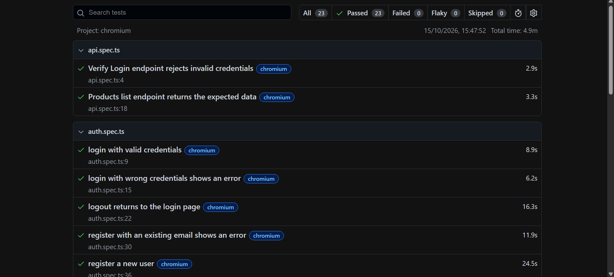

# Playwright E2E Framework


End-to-end test automation framework for [Automation Exercise](https://automationexercise.com), a public e-commerce practice site. Built with **Playwright** and **TypeScript**, using the **Page Object Model**, API-driven test setup, and **GitHub Actions** CI.

The base scenarios come from the site's published test case list. I selected, extended, and reorganised them, and added my own: account deletion, API tests, invalid-input checks, and field-by-field address verification.

## What's covered

| Area | Scenarios |
|------|-----------|
| **Auth** | Register, register with an existing email, login (valid and invalid), logout, delete account then try to log in, invalid registration input (bad email format, missing field) |
| **Products** | Product list matches the API, product detail page, search, add a review |
| **Cart** | Add products, verify quantity and totals, remove a product, cart persists after login |
| **Checkout** | Place an order after login, register before checkout, delivery and billing address verification, invoice download |
| **Contact** | Contact form with file upload and alert dialog |
| **API** | Products list endpoint, `verifyLogin` with valid and invalid credentials |

The full list with IDs (TC01 to TC22) is in [`test-plan.md`](test-plan.md).
   ## Test report

   
   
## Design highlights

- **UI + API combined.** A custom `apiUser` fixture creates a user through the API before the test and deletes it afterwards. Tests that need an existing account skip the slow UI registration, and nothing is left behind.
- **Page Object Model.** Page classes hold locators and actions, while assertions stay in the tests.
- **Unique test data on every run.** A `generateUser()` helper builds realistic users with Faker, with timestamped emails so runs never collide.
- **Stable tests on a flaky site.** Ad requests are blocked in a `page` fixture override so interstitials can't intercept clicks. Text assertions normalise whitespace, because the site injects extra links into some product names.
- **Cleanup built in.** Tests that register users through the UI delete the account at the end.
- **Failure diagnostics.** Traces are recorded on retry, and the HTML report is uploaded as a CI artifact.

## Tech stack

Playwright, TypeScript, Faker, GitHub Actions

## Project structure

```
├── .github/workflows/   # CI pipeline
├── fixtures/            # apiUser fixture (API setup/teardown, ad blocking)
├── pages/               # Page Objects (login, products, checkout, ...)
├── tests/               # Spec files grouped by feature
├── utils/               # Test data generator and helpers
├── test-plan.md         # Scenarios, IDs, and status
└── playwright.config.ts
```

## Getting started

Requires Node.js 18 or later.

```bash
git clone https://github.com/miramd/playwright-e2e-framework.git
cd playwright-e2e-framework
npm ci
npx playwright install 
npx playwright test
```

Useful commands:

```bash
npx playwright test --headed          # watch the browser
npx playwright test -g "TC14"         # run tests matching a name
npx playwright show-report            # open the HTML report
```

## Continuous integration

Every push to `main` runs the suite on GitHub Actions. The HTML report, including traces for any failures, is attached to each run as an artifact (Actions tab, then the run, then Artifacts). CI runs on chromium, webkit and firefox.

## Run with Docker
docker build -t pw-tests .
docker run --rm --ipc=host -v "$(pwd)/playwright-report:/app/playwright-report" pw-tests npx playwright test --project=chromium --workers=2

## Notes

- The target site is a public practice application, so tests only use throwaway accounts and dummy payment data.
- Some tests depend on the site's responsiveness. Retries are enabled in the config, and failures keep a trace for debugging.

## Author

**Mira Al Madani**, QA Engineer
[LinkedIn](https://lb.linkedin.com/in/mira-al-madani) | [GitHub](https://github.com/miramd)